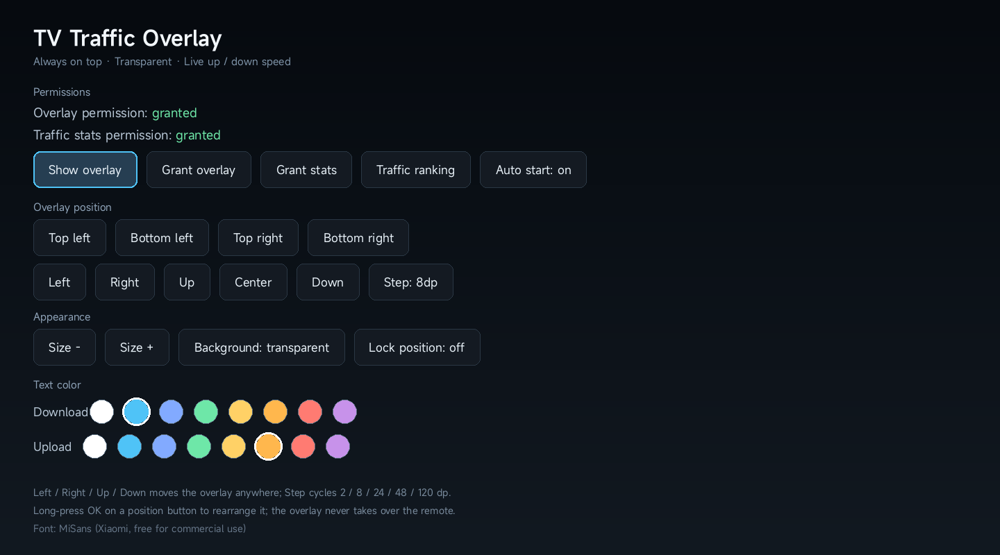
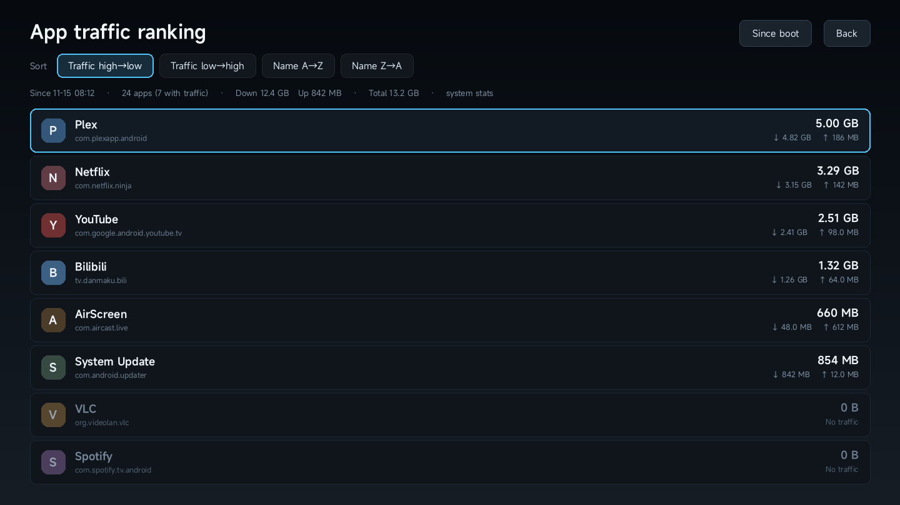
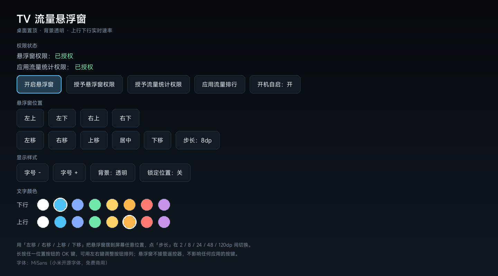
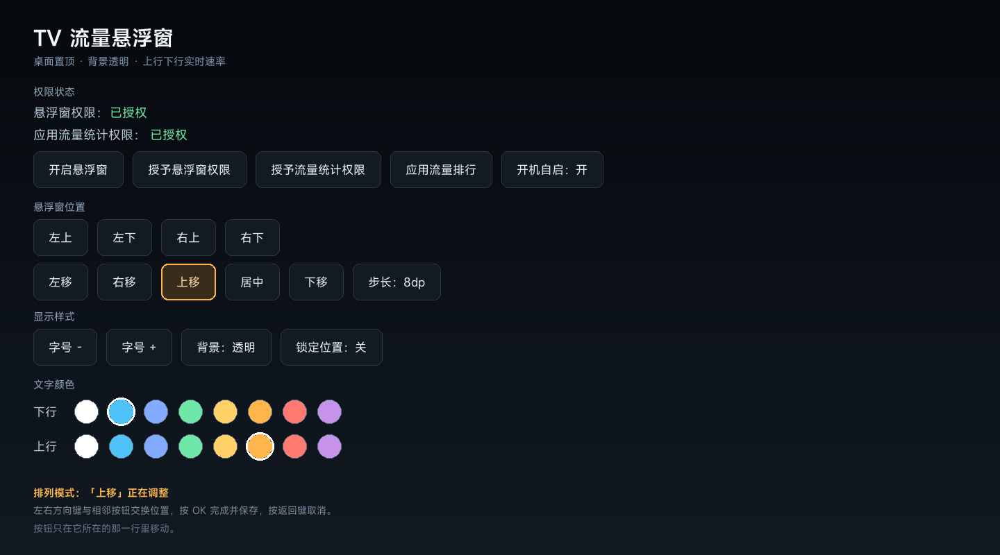
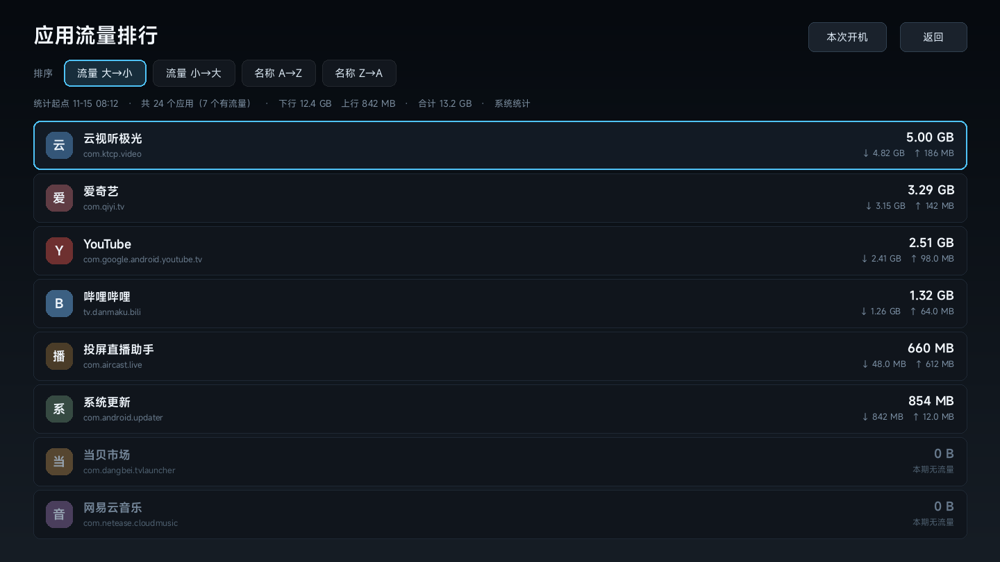
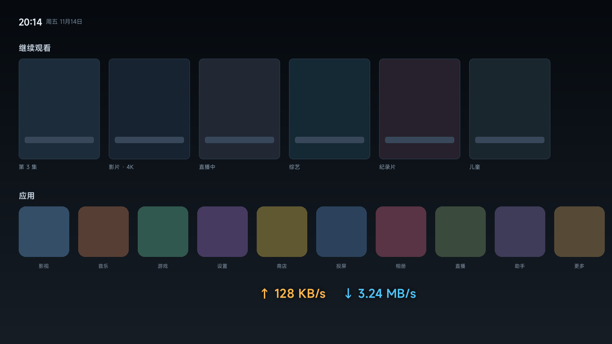

# TV Traffic Overlay

[](https://github.com/ac523279673/TvTrafficOverlay/actions/workflows/build.yml)
[](https://github.com/ac523279673/TvTrafficOverlay/releases/latest)
[](LICENSE)
[](https://developer.android.com)

[简体中文](README.md) | **English**

A live network speed overlay for Android TV and TV boxes. Fully transparent, always on top: see upload and download speed at a glance, and check per-app traffic usage.

Pure Android framework, no third-party dependencies. Source is MIT licensed. The UI ships in English and Simplified Chinese, following the system language. **Runs on Android 4.0 (API 14) and newer**, so old TV boxes are supported too.

## Screenshots

| Settings | App ranking |
|---|---|
|  |  |

The Chinese UI:

| Settings | Arrange mode | App ranking |
|---|---|---|
|  |  |  |

The overlay itself (transparent, upload on the left, download on the right):



## Features

| Feature | Notes |
|---|---|
| Live speed | Refreshed every second, **upload on the left, download on the right** (`↑` up, `↓` down); units switch automatically between B/KB/MB/GB |
| Transparent, on top | Draws text only. A text shadow keeps it readable on bright content; an optional translucent background is one tap away |
| Free positioning | Drag it anywhere with touch or a mouse, or use Left / Right / Up / Down in settings to push it to the **very edge** of the screen. Step size 2 / 8 / 24 / 48 / 120 dp, plus Center to jump back to the middle. Stored as screen ratios, so it survives resolution changes |
| Four corners | Top left / bottom left / top right / bottom right, one button each |
| Text colour | Separate colours for download and upload, 8 swatches each; dark colours automatically get a light shadow |
| All installed apps | **Every installed app is listed**, including those with no traffic in the period (sorted to the bottom and dimmed). Ranges: since boot / last 7 days / last 30 days. Each row shows the **total**, with the up/down split underneath |
| Sort menu | Always-visible chips: traffic high→low, low→high, name A→Z, Z→A |
| Never grabs focus | Permanently `FLAG_NOT_FOCUSABLE`. The overlay never takes over the remote, so every other app keeps its keys and back button |
| Auto start | Restores the overlay after boot if it was on, and after an update. Can be turned off |
| Global font | Bundled MiSans for both the overlay and the settings screen; digits use a fixed-width measurement so the readout does not jitter |
| Position lock | Prevents accidental drags |
| Bilingual | All UI strings live in resources: `values-zh` for Simplified Chinese, English as the default. Chinese system language gets Chinese, everything else gets English |
| Legacy support | Works from Android 4.0 (API 14): 4.x uses a `TYPE_PHONE` overlay with the Holo theme, 5.0+ switches to Material and `TYPE_APPLICATION_OVERLAY` |

## Install

Grab `TvTrafficOverlay-v1.0-android4.apk` (about 2.4 MB) from the **Releases** page, or build it yourself (see below).

> Releases ships two builds: **`v1.0`** requires Android 6.0+; **`v1.0-android4`** goes down to Android 4.0 and covers 4.0 through the latest release — use it for old TV boxes. Both share the same package name and signing key, so either installs over the other and keeps your settings.

Three ways to install:

1. **USB drive**: copy the APK to a drive, plug it into the TV, open it with the built-in file manager (allow "install unknown apps").
2. **adb**: `adb connect TV_IP:5555` then `adb install -r TvTrafficOverlay-v1.0-android4.apk`
3. **TV assistant apps** such as Dangbei Assistant or Shafa Market.

> The APK in Releases is signed with the default Android debug certificate and is meant for sideloading. If you redistribute it or publish it, sign it with your own keystore.

Requires Android 4.0 (API 14) or newer. Works on TVs, boxes and phones. On Android 6.0 and older the per-app ranking only covers the current boot — see [Compatibility](#compatibility-android-40--60).

## Granting permissions (important)

TV systems usually have **no** settings entry for "Display over other apps" or "Usage access", so grant them over adb:

```bash
adb connect 192.168.x.x:5555          # your TV's IP; enable network debugging in developer options first
adb shell appops set com.tvtraffic.overlay SYSTEM_ALERT_WINDOW allow
adb shell appops set com.tvtraffic.overlay GET_USAGE_STATS allow
```

- The first one is the **overlay permission**; without it the overlay never appears.
- The second is the **usage access permission**; without it the app ranking screen cannot open. Live speed is unaffected, because it reads system-wide `TrafficStats`.

Come back to the app and both status lines turn green.

Some devices (Xiaomi TVs, some projectors) do expose "App permissions → Display over other apps" in settings; if yours does, you can skip the first command.

> **Android 6.0 and older does not need this step**: the overlay permission is granted at install and there is no usage-access switch. The settings screen shows a grey "not required" and hides the grant button.

## Usage

1. Open the app and check that both permissions show as granted.
2. Tap "Show overlay" and go back to the home screen — `↑ xx KB/s  ↓ xx MB/s` appears in the top right corner.
3. Position:
   - Touch / mouse: drag the overlay anywhere; the position is remembered on release. A single tap does nothing, so you cannot move it by accident.
   - Remote: use Left / Right / Up / Down in settings, one step per press; Step cycles 2 / 8 / 24 / 48 / 120 dp; Center puts it back in the middle.
   - The overlay never takes over the remote, so the remote keeps working in every app.
   - The four corner buttons jump straight to a corner.
   - **Custom order**: long-press OK on any position button for about 0.6 s — the button turns amber. Left / Right then swap it with a neighbour, OK saves, Back cancels. A button only moves inside its own row, and the order survives a restart.
4. Colours: pick a colour for download and upload under "Text color"; it applies immediately.
5. Font size, background and text colour can all be changed on the main screen without restarting.
6. Ranking: the button in the top right cycles the time range; sorting is a row of chips above the list. The list contains every installed app — **apps without traffic sit at the bottom, greyed out**. Moving with the remote highlights the selected row with a cyan outline; press OK for details (total, up/down, app type).
   At the end of the summary line you can see the data source: "system stats" means the numbers are complete, an orange "since boot only (grant usage access)" means the permission is missing and only some apps have data.

## How it works

- **Live speed**: `TrafficStats.getTotalRxBytes()/getTotalTxBytes()` sampled twice and divided by the time delta. This is the kernel interface counter, covering Wi-Fi, Ethernet and mobile data — no permissions, negligible battery cost.
- **Per-app traffic**: `NetworkStatsManager.querySummary()` aggregated by uid, querying Wi-Fi / mobile / Ethernet (type 9) separately and merging. The system persists this data, so historical ranges work. Without permission it falls back to `TrafficStats.getUidRxBytes()` (current boot only).
- **Overlay**: `TYPE_APPLICATION_OVERLAY` (Android 8+) / `TYPE_PHONE` (older), with `FLAG_NOT_FOCUSABLE | FLAG_NOT_TOUCH_MODAL | FLAG_LAYOUT_IN_SCREEN`. Corners are aligned with `Gravity`, so the window stays flush when its width changes.
- **Foreground service**: required by Android 8+, with an `IMPORTANCE_MIN` notification. `POST_NOTIFICATIONS` is neither declared nor requested, so Android 13+ never shows a permission dialog; the notification exists only as a service placeholder.
- **Auto start**: `BOOT_COMPLETED` / `QUICKBOOT_POWERON` / `MY_PACKAGE_REPLACED`. On boot the overlay is attached after an 8 s delay so the window service is ready and `addView` does not fail.
- **Position**: corners use `Gravity`; dragging or nudging switches to free mode, where coordinates are stored as **ratios** of screen width/height. Ratios are kept in memory and only written to disk on release, so the per-second style sync cannot drag the window back to an old position.
- **Bounds**: the window has `FLAG_LAYOUT_IN_SCREEN`, so `lp.x / lp.y` are full-screen coordinates and clamping must use the real screen size (`getMaximumWindowMetrics()` on API 30+, `Display.getRealMetrics()` below). `getResources().getDisplayMetrics()` returns the app's available area — on TVs the overscan safe area shrinks it, which is exactly why the window could never reach the right and bottom edges. With no background the container padding drops to 2 dp so the text visually touches the edge.
- **Font**: MiSans (Regular + DemiBold) in `assets/fonts/`, subset with fontTools (GB2312 + Latin + common symbols, 7544 characters), which brings each weight from 7.6 MB down to 1.7 MB.
- **Package visibility**: Android 11+ restricts `getInstalledApplications()` / `getPackagesForUid()` unless `QUERY_ALL_PACKAGES` is declared, which used to drop entries from the list.
- **List contents**: driven by `getInstalledApplications()` (disabled packages skipped), traffic looked up by uid. When several packages share a uid, each gets its own row marked "shared uid". Icons and labels are cached in memory so the 10 s refresh does not re-parse APKs.
- **Sorting**: names use `Collator.getInstance()` (follows the system language), so Chinese sorts by pinyin rather than UTF-16 code points. Sorting only affects presentation; it does not re-query.
- **Legacy support**: `minSdk 14`. Android 4.0–4.4 still runs Dalvik, where any reference to a class the platform does not have can throw `VerifyError`, so `AppOpsManager` (19+), `NetworkStatsManager` (23+) and `NotificationChannel` (26+) each live in their own class (`UsageAccess`, `NetworkStatsQuery`, `NotiCompat`) that is never loaded on old versions; scattered newer methods such as `Long.compare` (19+) and `View.setBackground` (16+) are funnelled through `Compat`.
- **Localisation**: every UI string lives in `strings.xml` — English in `values/`, Simplified Chinese in `values-zh/`. English labels are longer, and the first button row overflows the available width on a 1280×720 TV (about 757 dp), so that row is wrapped in a `HorizontalScrollView` that follows focus.

## Compatibility (Android 4.0 ~ 6.0)

Old TV boxes (4.0–4.4) and modern systems use two different sets of APIs:

| Capability | Android 4.0 ~ 5.1 (API 14–22) | Android 6.0+ (API 23+) |
|---|---|---|
| Live speed | ✅ `TrafficStats` kernel counters, no permission | ✅ Same |
| Overlay | ✅ `TYPE_PHONE`, permission granted at install | ✅ `TYPE_APPLICATION_OVERLAY`, must be granted in settings |
| Theme | Holo (`values/`) | Material (`values-v21/`) |
| Per-app ranking | ⚠️ Only `TrafficStats.getUidRxBytes()`, i.e. **since boot**; some 4.x kernels do not track per-uid counters and show 0 | ✅ `NetworkStatsManager`, 7-day / 30-day ranges survive reboots |
| Range button | Greyed out, fixed to "Since boot" | Three ranges, switchable |

The ranking header on 4.x says "since boot only (Android 5.1 and older has no long-term stats)" — that is expected, not a bug.

## Known limitations

- The overlay sits above **all** windows, including full-screen video. On some devices the DRM layer (Netflix and similar) covers it; this is a system restriction with no workaround.
- The speed shown is the **whole device** (all interfaces summed), not per app. Per-app live speed would need high-frequency `NetworkStatsManager` queries — too much power and latency for little gain.
- Ethernet: on some TVs the wired interface is missing from NetworkStats, so the ranking may under-report wired traffic, while live speed stays correct (kernel counters).
- The ranking is built from installed apps, so no package is missing; conversely, uids without an installed package (kernel threads, leftovers from uninstalled apps, some system daemons) do not appear.
- Android 6.0 and older has no `NetworkStatsManager`; the ranking is limited to the current boot. On a few 4.x kernels `getUidRxBytes()` returns `UNSUPPORTED`, so every app shows 0 while live speed still works.
- When several apps share a uid (e.g. `android.uid.system`) their traffic cannot be split; each shows the same number marked "shared uid", and the summary de-duplicates by uid so nothing is double counted.

## Changelog

**v1.0-android4** (legacy build)

- Same code as v1.0, with the minimum lowered from Android 6.0 to **Android 4.0 (API 14)** for older TV boxes
- 4.x uses a `TYPE_PHONE` overlay with the Holo theme; 5.0+ keeps Material and `TYPE_APPLICATION_OVERLAY`
- Below 6.0 the per-app ranking falls back to "since boot" and says so; the range button is greyed out
- Below 6.0 there is no usage-access switch, so the permission row shows a grey "not required" and hides the grant button

**v1.0**

- First public release: live up/down speed, corner or free positioning, per-app ranking, English and Chinese
- Requires Android 6.0+

## Project layout

```
app/src/main/java/com/tvtraffic/overlay/
  MainActivity.java          Permission checks + settings screen (nudging, button arrangement)
  OverlayService.java        Foreground service + overlay + per-second sampling + bounds clamping
  TrafficSampler.java        Speed delta calculation
  AppUsageRepository.java    Traffic aggregation by uid (NetworkStatsManager + fallback)
  AppUsageActivity.java      App traffic ranking (sort chips / summary / details)
  Fonts.java                 MiSans loading and global application
  Fmt.java                   Speed / volume formatting
  Prefs.java                 Preferences
  BootReceiver.java          Auto start
  Compat.java                Legacy shims (overlay permission / setBackground / Long.compare)
  UsageAccess.java           Usage-access check (AppOpsManager, API 19+, isolated)
  NetworkStatsQuery.java     NetworkStatsManager queries (API 23+, isolated)
  NotiCompat.java            Notification channel (API 26+, isolated)
app/src/main/res/
  values/strings.xml         English (default)
  values-zh/strings.xml      Simplified Chinese
  values/styles.xml          Base theme (Holo, API 14+)
  values-v21/styles.xml      Material theme for Android 5.0+
```

## Building

```bash
# Requires JDK 17+ and an Android SDK (platform 34, build-tools 34.0.0)
git clone https://github.com/ac523279673/TvTrafficOverlay.git
cd TvTrafficOverlay
echo "sdk.dir=/path/to/android-sdk" > local.properties
./gradlew assembleDebug
# Output: app/build/outputs/apk/debug/app-debug.apk
```

`assembleRelease` needs your own `signingConfig` in `app/build.gradle`; the repository ships no signing material.

No third-party dependencies, pure framework. The APK is about 2.6 MB, of which the fonts take 3.4 MB uncompressed.

## License

Source code is under the **MIT License**, see [LICENSE](LICENSE).

The bundled **MiSans** font does not fall under MIT: it is published by Xiaomi and free for commercial use, but the font itself may not be modified or resold, and you must credit MiSans. The files in this repository are character subsets with unmodified glyphs. Details and how to replace them are in [THIRD_PARTY_NOTICES.md](THIRD_PARTY_NOTICES.md).

## Disclaimer

The app reads `TrafficStats` and `NetworkStatsManager` through public Android APIs. It does not capture packets, does not read app content, and does not upload anything — all statistics stay on the device.

The software is provided "as is", without warranty of any kind. The author is not liable for device issues or inaccurate numbers; please evaluate before installing it on your device.

## Contributing

- Found a bug or have an idea? Open an issue, ideally with the device model, Android version and steps to reproduce.
- Before sending a PR, make sure `./gradlew assembleDebug` passes; for UI changes a screenshot helps.
- The project deliberately stays "zero dependency, pure framework" — please explain the reasoning before adding a library.
