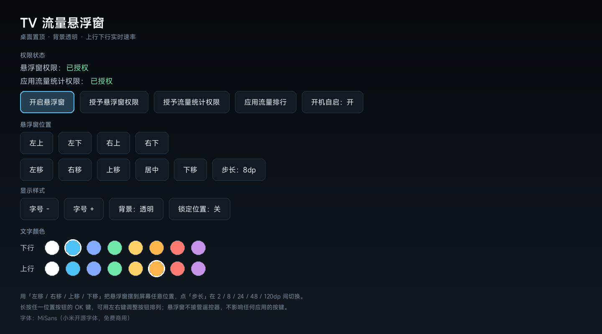
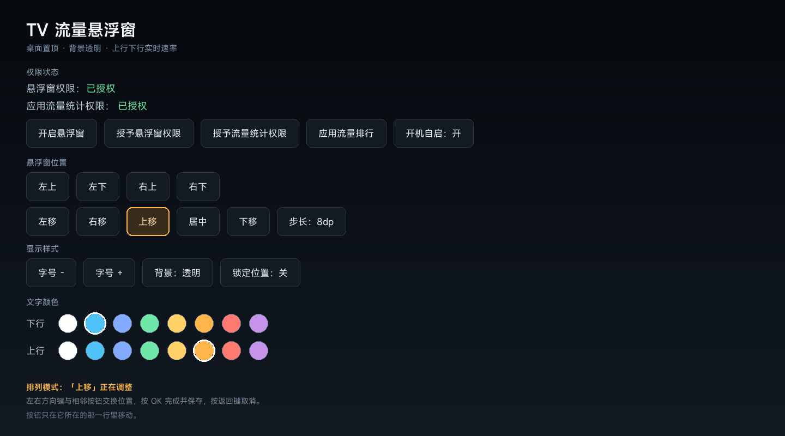
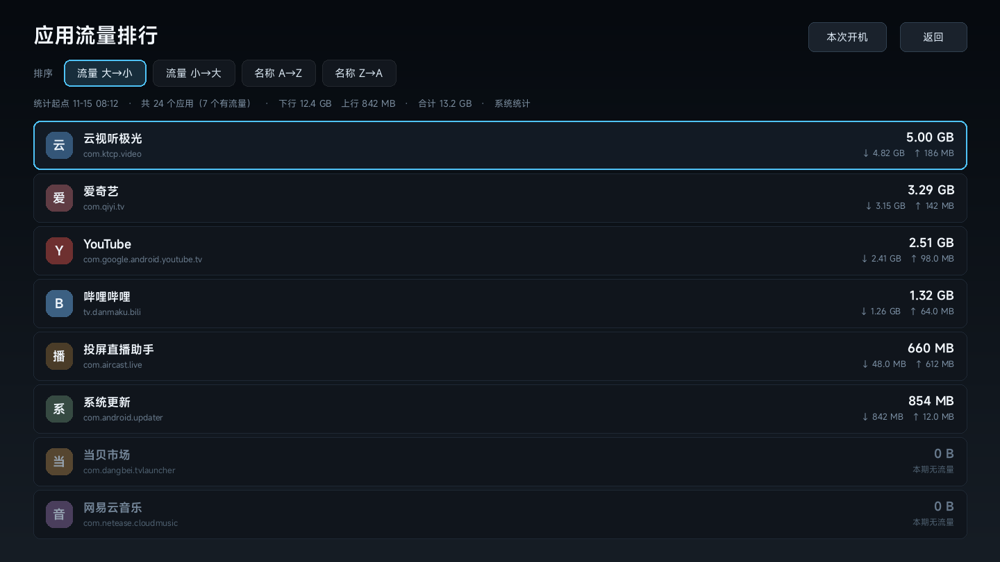
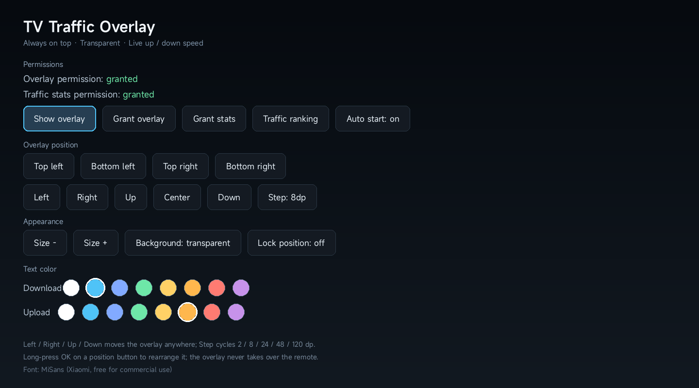
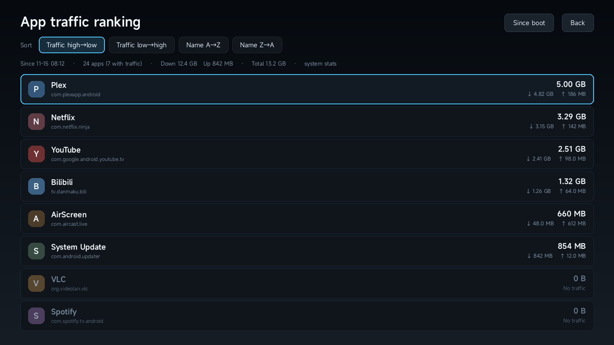
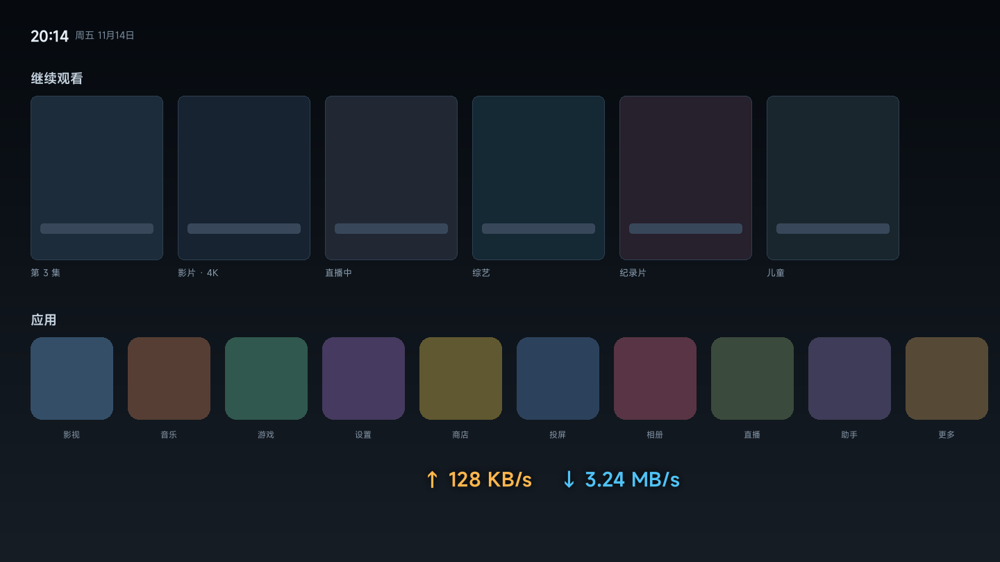

# TV 流量悬浮窗（TvTrafficOverlay）

[](https://github.com/ac523279673/TvTrafficOverlay/actions/workflows/build.yml)
[](https://github.com/ac523279673/TvTrafficOverlay/releases/latest)
[](LICENSE)
[](https://developer.android.com)

**简体中文** | [English](README.en.md)

安卓电视 / 电视盒子用的实时网速悬浮窗。背景完全透明、置顶显示，随时看上下行速率，并可按应用统计流量。

纯 Android framework 实现，无任何第三方依赖；源码以 MIT 协议开源。界面中英双语，随系统语言自动切换。

## 界面预览

| 设置页 | 排列模式 | 应用流量排行 |
|---|---|---|
|  |  |  |

英文界面（系统语言为英文时自动启用）：

| 设置页 | 应用排行 |
|---|---|
|  |  |

悬浮窗本体（透明背景，上行在左、下行在右）：



## 功能

| 功能 | 说明 |
|---|---|
| 实时速率 | 每秒刷新，**上行在左、下行在右**（`↑` 上行、`↓` 下行），自动切换 B/KB/MB/GB 单位 |
| 透明置顶 | 悬浮窗不占用画面，只画文字（带阴影，亮背景也看得清），可一键切成半透明底 |
| 自定义位置 | 可直接拖动到任意位置（触屏/鼠标），也可在设置页用「左移/右移/上移/下移」把悬浮窗摆到**屏幕最边缘**；步长 2/8/24/48/120dp 可调，另有「居中」一键回到屏幕中央；位置按屏幕比例保存，换分辨率不跑位；位置区按钮支持长按 OK 键自定义排列 |
| 四角预设 | 左上 / 左下 / 右上 / 右下，四个按钮直接定位，不再有循环切换 |
| 文字颜色 | 下行/上行各自选色，8 色色板；深色文字自动配浅色阴影，任何画面都看得清 |
| 全部应用流量 | **所有已安装应用都列出**（本期没跑流量的也列，沉底灰显），不会因为某个应用当期没流量就消失；支持「本次开机 / 近 7 天 / 近 30 天」；列表显示每个应用的**流量总和**，下行一行小字给细分 |
| 排序菜单 | 排序方式常驻一行菜单（流量 大→小、流量 小→大、名称 A→Z、名称 Z→A），点哪项按哪项排，不再单键循环切换 |
| 不抢焦点 | 恒定 `FLAG_NOT_FOCUSABLE`，永远不接管遥控器，不影响任何应用的按键与返回操作 |
| 开机自启 | 上次关闭前是开启状态，开机后自动恢复（可单独关闭）；升级安装后也会自动恢复 |
| 全局字体 | 内置 MiSans，悬浮窗与设置页统一；数字区锁定宽度，读数跳动时不会左右抖 |
| 位置锁定 | 防止误触改位置 |
| 中英双语 | 界面文案全部走资源，中文放 `values-zh`、英文为默认；系统语言是中文就用中文，其它语言用英文 |

## 安装

到本仓库的 **Releases** 页下载 `TvTrafficOverlay-v1.0.apk`（约 2.4 MB）。也可以自己编译，见文末「自己编译」。

装法三种任选：

1. **U 盘**：拷到 U 盘 → 插电视 → 用电视自带的文件管理器打开安装（需允许「安装未知来源应用」）。
2. **adb**：`adb connect 电视IP:5555` → `adb install -r TvTrafficOverlay-v1.0.apk`
3. **电视助手类 App**（当贝助手、沙发管家等）推送安装。

> Release 里的 APK 使用 Android 默认 debug 证书签名，仅适合自行安装。若要分发给他人或上架，请用自己的 keystore 重新签名。

要求：Android 6.0（API 23）及以上，电视/盒子/手机都能装。

## 首次使用必须授权（关键）

电视系统一般**没有**「显示在其他应用上层」和「使用情况访问」的设置入口，只能用 adb 授权：

```bash
adb connect 192.168.x.x:5555          # 电视的 IP，需先在开发者选项里打开网络调试
adb shell appops set com.tvtraffic.overlay SYSTEM_ALERT_WINDOW allow
adb shell appops set com.tvtraffic.overlay GET_USAGE_STATS allow
```

- 第一条是**悬浮窗权限**，没有它悬浮窗根本不会出现。
- 第二条是**应用流量统计权限**，没有它「应用流量排行」打不开；实时速率不受影响（走的是系统级 TrafficStats，不需要权限）。

授权完回到 App 主界面，两行状态会变成绿色的「已授权」。

部分机型（小米电视、部分投影）在系统设置里有「应用权限 → 显示悬浮窗」，能点的就直接点，省掉第一条命令。

## 使用

1. 打开 App，确认两项权限都是「已授权」。
2. 点「开启悬浮窗」，回到桌面即可看到右上角的 `↑ xx KB/s  ↓ xx MB/s`（上行在前）。
3. 位置：
   - 触屏 / 鼠标：直接按住悬浮窗拖到任意位置，松手即记住；轻点不做任何事，避免误触改位置。
   - 遥控器：在设置页点「左移 / 右移 / 上移 / 下移」，每按一次移动一个步长；点「步长」在 2 / 8 / 24 / 48 / 120dp 之间切换；「居中」直接摆到屏幕正中。
   - 悬浮窗不接管遥控器，所以在任何界面下遥控器都照常可用。
   - 四个角按钮直接定位，没有循环切换。
   - **自定义排列**：长按位置区任一按钮的 OK 键约 0.6 秒，该按钮变成琥珀色，此时左右方向键与相邻按钮交换位置；按 OK 保存，按返回键取消。排列只在该按钮所在的那一行内进行，重启后保持。
   - 悬浮窗内 **上行在左、下行在右**。
4. 颜色：在「文字颜色」里给下行、上行分别选色，点完立即生效。
5. 字号、背景、文字颜色都可在主界面调，改完立刻生效，不用重开。
6. 应用排行：右上角按钮切换 **时间范围**；排序在列表上方的一行菜单里直接点选（流量大→小、流量小→大、名称 A→Z、名称 Z→A），选中的那项高亮。列表包含全部已安装应用，**没流量的排在最后并灰显**，标「本期无流量」。用遥控器上下移动时，选中行有青色描边；按 OK 键看该应用的详情（合计、上下行、类型）。
   页面顶部那行小字末尾会标数据来源：显示「系统统计」说明数据完整；显示橙色的「仅本次开机（建议授予使用情况访问权限）」说明权限没给，只有部分应用有数。

## 实现说明

- **实时速率**：`TrafficStats.getTotalRxBytes()/getTotalTxBytes()` 两次采样差分 ÷ 时间差。这是内核网卡计数，覆盖 Wi-Fi、有线、移动网络全部接口，零权限、零耗电。
- **应用流量**：`NetworkStatsManager.querySummary()` 按 uid 聚合，分别查 Wi-Fi / 移动网络 / 以太网（type 9）三个通道后合并。数据由系统持久化，所以能查历史区间。拿不到权限时自动退化为 `TrafficStats.getUidRxBytes()`（仅本次开机）。
- **悬浮窗**：`TYPE_APPLICATION_OVERLAY`（Android 8+）/ `TYPE_PHONE`（更低版本），`FLAG_NOT_FOCUSABLE | FLAG_NOT_TOUCH_MODAL | FLAG_LAYOUT_IN_SCREEN`，四角吸附直接用 `Gravity` 对齐屏幕边缘，不再有可调边距。
- **常驻**：前台服务 + `IMPORTANCE_MIN` 通知（系统强制要求，无法完全去掉），符合 Android 8+ 后台限制；Android 12+ 从 `BOOT_COMPLETED` 启动前台服务属于系统豁免场景。**不声明也不申请 `POST_NOTIFICATIONS`**，Android 13+ 不会弹通知权限框，通知仅作为服务占位存在。
- **开机自启**：`BOOT_COMPLETED` / `QUICKBOOT_POWERON` / `MY_PACKAGE_REPLACED` 三个入口，开机场景会延后 8 秒再挂悬浮窗，等窗口服务就绪，避免 `addView` 失败。
- **位置**：四角模式用 `Gravity` 对齐（窗口宽度变化也能贴边）；拖动或微调后转为自由模式，坐标以屏幕宽高**比例**存储，换分辨率按比例还原。比例在内存里有一份，拖动时逐帧只更新内存、松手才落盘，避免每秒的样式同步把窗口拽回旧坐标。
- **边界**：窗口带 `FLAG_LAYOUT_IN_SCREEN`，`lp.x / lp.y` 是整块屏幕坐标，因此夹取必须用真实屏幕尺寸（API 30+ `getMaximumWindowMetrics()`，更低版本 `Display.getRealMetrics()`）。用 `getResources().getDisplayMetrics()` 会拿到应用可用区域——电视的 overscan 安全区把它缩掉一圈，右下角就永远差一截、推不到边。无背景时容器内边距收到 2dp，让文字视觉上真正贴住屏幕边。
- **字体**：`assets/fonts/` 内为 MiSans（Regular + DemiBold），已用 fontTools 做子集化（保留 GB2312 全集 + 拉丁 + 常用符号，共 7544 字符），单字重从 7.6 MB 压到 1.7 MB。
- **包可见性**：Android 11+ 有包可见性限制，未声明 `QUERY_ALL_PACKAGES` 时 `getInstalledApplications()` / `getPackagesForUid()` 只返回部分应用，列表会缺项。已在清单里声明该权限。
- **列表构成**：以 `getInstalledApplications()` 为准逐包列出（跳过已停用），流量按 uid 从 NetworkStats 取；一个 uid 多个包时每个包各占一行，标注「共用 uid」。图标与名称做了内存缓存，避免 10 秒自动刷新时反复解析 APK。
- **排序**：名称排序用 `Collator.getInstance()`（跟随系统语言），中文按拼音而不是 UTF-16 码位；排序只影响展示，不重新查询。
- **多语言**：所有界面文案都在 `strings.xml`，默认资源是英文、`values-zh` 是简体中文，Android 按系统语言自动选。英文比中文长，首行按钮在 1280×720 的电视上会超出可用宽度，所以那一行套了 `HorizontalScrollView`，焦点走到哪就滚到哪。

## 已知限制

- 悬浮窗盖在**所有**窗口之上，包括全屏视频。看 Netflix 等 DRM 内容时，部分设备的加密图层会遮住悬浮窗（系统限制，无法绕过）。
- 速率是**整机合计**（所有网卡加总），不是单个 App 的速率。要单 App 实时速率需要 `NetworkStatsManager` 高频查询，功耗和延迟都不划算，所以没做。
- 有线网卡：个别电视的以太网统计没进 NetworkStats，应用排行里可能缺失，但实时速率仍然正确（来自内核计数）。
- 应用排行以「已安装应用」为准逐个列出，所以不会漏包；反过来，没有对应已安装应用的 uid（内核线程、已卸载应用的残留、部分系统守护进程）不会出现在列表里。
- 多个应用共用同一个 uid（如 `android.uid.system`）时，它们的流量无法拆开，会各自显示同一份数值并标「共用 uid」，顶部合计已按 uid 去重，不会重复累加。

## 工程结构

```
app/src/main/java/com/tvtraffic/overlay/
  MainActivity.java          权限检测 + 设置界面（位置微调、按钮排列）
  OverlayService.java        前台服务 + 悬浮窗 + 每秒采样 + 位置夹取
  TrafficSampler.java        速率差分计算
  AppUsageRepository.java    按 uid 聚合流量（NetworkStatsManager + 兜底）
  AppUsageActivity.java      应用流量排行（排序菜单 / 合计 / 详情）
  Fonts.java                 MiSans 字体加载与全局应用
  Fmt.java                   速率/流量格式化
  Prefs.java                 配置项
  BootReceiver.java          开机自启
```

## 自己编译

```bash
# 需要 JDK 17+、Android SDK（platform 34、build-tools 34.0.0）
git clone https://github.com/ac523279673/TvTrafficOverlay.git
cd TvTrafficOverlay
echo "sdk.dir=/path/to/android-sdk" > local.properties
./gradlew assembleDebug
# 产物：app/build/outputs/apk/debug/app-debug.apk
```

`assembleRelease` 需要在 `app/build.gradle` 里补上自己的 signingConfig，仓库不包含任何签名材料。

无第三方依赖，纯 framework 实现。APK 约 2.4 MB，其中字体占 3.4 MB（未压缩）。

## 许可证

本项目源码采用 **MIT License**，见 [LICENSE](LICENSE)。

内置的 **MiSans** 字体不遵循 MIT，由小米发布、免费商用，但**不得改编字体本身、不得单独转售**，且需注明使用了 MiSans。仓库内的字体为字符集子集（未改动字形），详细说明与替换方式见 [THIRD_PARTY_NOTICES.md](THIRD_PARTY_NOTICES.md)。

## 免责声明

本项目通过 Android 公开 API 读取 `TrafficStats` 与 `NetworkStatsManager`，不抓包、不读取应用内容、不联网上传任何数据，全部统计都在本机完成。

软件按「现状」提供，不附带任何担保。因使用本软件造成的设备异常、数据统计偏差等，作者不承担责任；请自行评估后再安装到你的设备上。

## 参与

- 发现 bug 或有功能建议，欢迎提 Issue，尽量附上设备型号、Android 版本和复现步骤。
- 提交 PR 前请保证 `./gradlew assembleDebug` 能通过；改动界面的话，附一张截图更好。
- 这个项目刻意保持「零依赖、纯 framework」，引入第三方库前请先说明理由。
